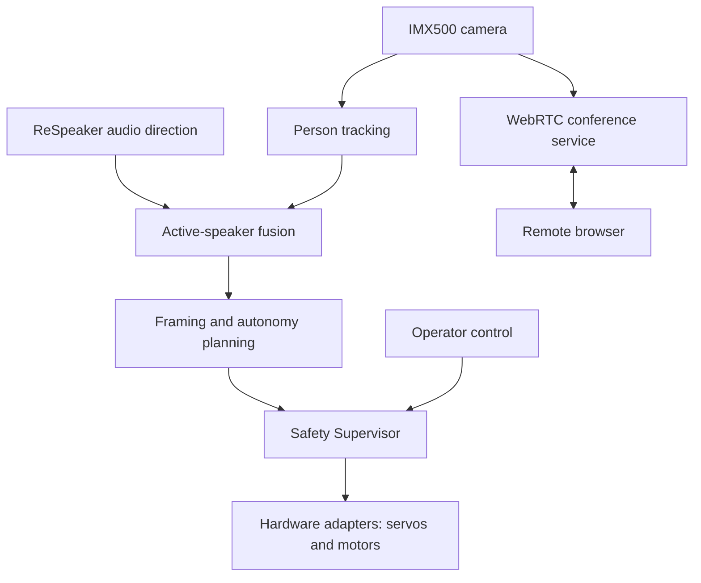

# 🤖 ZeeAIBotWebCam

### AI-powered telepresence for hybrid learning

**A Raspberry Pi research and teaching platform for camera framing, active-speaker tracking and supervised robotic video conferencing.**

[](https://github.com/zk222ac001/ZeeAIBotWebCam/actions/workflows/ci.yml)
[](pyproject.toml)
[](LICENSE)

[**Get started**](#quick-start--no-robot-required) · [**Documentation**](docs/README.md) · [**Deploy on Pi**](docs/studio-deployment.md) · [**Release workflow**](docs/production-release.md) · [**Privacy**](docs/privacy.md) · [**Security**](SECURITY.md)

---

## The project

ZeeAIBotWebCam explores affordable robotic presence in hybrid active-learning classrooms. It combines **Hiwonder TurboPi**, **Raspberry Pi**, **Sony IMX500 AI Camera**, **ReSpeaker XVF3800**, **Python** and **WebRTC**.

The goal is to help remote participants see, hear and follow classroom activity through a locally operated robot. Person detection uses temporary tracking labels; it does not identify students.

> [!IMPORTANT]
> **Research prototype / supervised preview.** Software features are implemented, but physical acceptance, acoustic echo validation and the full classroom pilot remain essential. Autonomous room navigation and docking are not implemented. Passing CI is not proof that a robot is safe to operate.

## What is included?

| Capability | Implementation and limits |
| --- | --- |
| 🖥️ ZeeAI Studio | Responsive operator overview, live session, camera controls and readiness pages; local frontend assets |
| 📷 Camera and tracking | Shared IMX500 camera service, person detections and temporary tracking labels |
| 🎙️ Active-speaker framing | Audio direction and visual detections combined with calibration gates |
| ↔️ Pan/tilt | Bounded execution; Pi starts in center-and-hold until following is explicitly resumed |
| 🌐 WebRTC | Browser video/audio with separate conference access settings |
| 🛞 Robot control | Leased manual control, heartbeat/watchdog and central safety supervision |
| 🧭 Supervised autonomy | Pi profile remains unarmed at startup and plan-only; rotation-only policy, forward/search disabled |
| 🧪 Development | Mock backends, pytest tests, Ruff checks and staged validation scripts |

## Quick start — no robot required

Use **Python 3.11–3.13**. These commands are for Bash on Linux/macOS; on Windows, activate the virtual environment using `.venv\Scripts\Activate.ps1` in PowerShell.

```bash
git clone https://github.com/zk222ac001/ZeeAIBotWebCam.git
cd ZeeAIBotWebCam
python3 -m venv .venv
source .venv/bin/activate
python -m pip install -e ".[dev]"
```

In a fresh terminal without deployment environment overrides, start the default mock profile:

```bash
python -m robotic_classroom.main
```

Open **http://127.0.0.1:8000/**. Stop with **Ctrl+C**.

The default `config.yaml` binds to loopback, uses mock hardware/camera/audio/conferencing and disables chassis motion. Mock conference signaling tests API/session behavior; it does **not** provide a real browser media connection. Environment variables can override configuration, so do not reuse a Pi service environment for this demo.

Verify the development setup:

```bash
ruff check src tests scripts
pytest -v
```

## Choose your configuration deliberately

| Setting | `config.yaml` | `config.pi.yaml` |
| --- | --- | --- |
| Hardware / camera / audio | Mock | Real / IMX500 / XVF3800 |
| Web binding | `127.0.0.1:8000` | `0.0.0.0:8000` |
| Manual chassis motion | Disabled | Enabled, subject to safety gates |
| Pan/tilt | Plan-only; hardware disabled | Execute; center hold at startup |
| Autonomy | Disabled / plan-only | Enabled / plan-only; pilot incomplete |
| Conference and control authentication | Disabled in YAML | Disabled in YAML; configure local overrides |
| Recording / face recognition | Disabled | Disabled |

> [!WARNING]
> The Pi profile is a hardware configuration, **not a secure deployment preset**. Enable separate conference and control authentication, configure HTTPS/private network access and revalidate calibration on your own robot before use. Never copy validation flags as evidence that different hardware has passed testing.

Follow [Studio deployment](docs/studio-deployment.md), [hardware validation](docs/phase-02-hardware-validation.md) and [systemd deployment](docs/phase-15-systemd-deployment.md). Install optional WebRTC dependencies with `python -m pip install -e ".[dev,webrtc]"` when that stage requires them.

## How the system fits together



This is a conceptual overview. Mode, calibration, access and safety gates determine whether a plan can execute. See [architecture](docs/architecture.md) and [safety](docs/safety.md).

## Explore ZeeAI Studio

| Page | Purpose |
| --- | --- |
| `/` | Room overview and service state |
| `/conference` | Explicit WebRTC connection and browser-microphone controls |
| `/api/pan-tilt/ui` | Center/hold and deliberate camera-following controls |
| `/api/control/ui` | Leased manual motion, STOP and emergency stop |
| `/readiness` | Live blockers and readiness report |

A successful servo command is not measured physical position. A loaded webpage does not prove WebRTC connectivity. Use `/api/readiness` and the supervised validation guides; `/ready` alone is not a production acceptance check.

## Documentation paths

| Your goal | Start here |
| --- | --- |
| Understand the project | [Documentation index](docs/README.md) |
| Set up a development environment | [Phase 1](docs/phase-01-development-environment.md) |
| Validate real hardware | [Phase 2](docs/phase-02-hardware-validation.md) |
| Deploy and secure Studio | [Studio deployment](docs/studio-deployment.md) |
| Calibrate speaker framing | [Pan-aware calibration](docs/pan-aware-speaker-calibration.md) |
| Run a stationary classroom trial | [Stationary validation](docs/stationary-classroom-validation.md) |
| Assess production readiness | [Phase 16](docs/phase-16-production-readiness.md) |
| Understand future autonomy | [Classroom roadmap](docs/classroom-autonomy-roadmap.md) |
| Review privacy and GitHub protection | [Privacy](docs/privacy.md) · [Repository review](docs/repository-security-review.md) |

## Privacy and responsible operation

Recording and face recognition are disabled in the committed profiles. Live video/audio can still identify people and is transmitted to connected conference participants. Temporary tracking labels do not anonymize the media itself.

Keep credentials and classroom recordings out of Git. Review logs, screenshots and reports before sharing them. Use the [privacy guide](docs/privacy.md) for the data flow and known limitations, and [SECURITY.md](SECURITY.md) for vulnerability reporting.

## Contribute

Read [CONTRIBUTING.md](CONTRIBUTING.md). Develop against mock backends, submit focused pull requests and document how changes were checked. Never run automated motion tests against a live classroom robot.

## Built with

- [Hiwonder TurboPi](https://github.com/Hiwonder/TurboPi)
- [Raspberry Pi Picamera2 / IMX500](https://github.com/raspberrypi/picamera2)
- [Seeed Studio ReSpeaker XVF3800](https://wiki.seeedstudio.com/respeaker_xvf3800_python_sdk/)
- [aiortc](https://github.com/aiortc/aiortc)

## License

[MIT](LICENSE). Third-party hardware SDKs and dependencies retain their own licenses.
